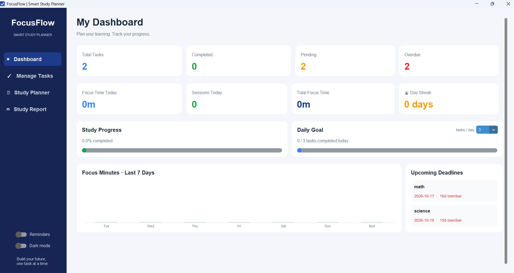
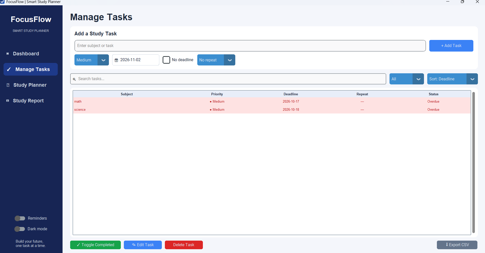
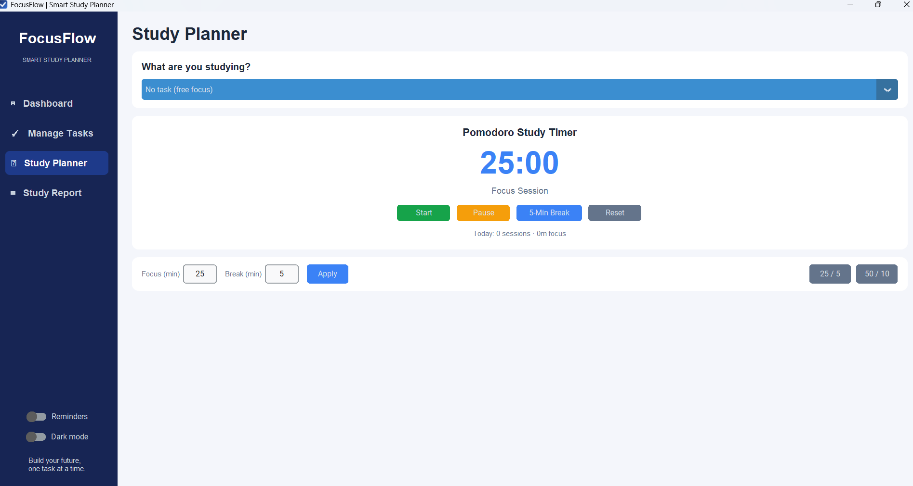

# FocusFlow – Smart Study Planner

A desktop study planner built with Python, customtkinter and SQLite. Plan tasks,
focus with a Pomodoro timer linked to those tasks, and track your progress.

## Screenshots

> Add your own screenshots to a `screenshots/` folder (press **Win + Shift + S**
> to capture), then keep or edit the lines below.

| Dashboard | Manage Tasks | Study Planner |
|---|---|---|
|  |  |  |

## Features

- **Tasks**: add, edit, complete/un-complete, delete (with confirmation)
- **Recurring tasks**: repeat daily, weekly or monthly. Finishing one creates the next automatically
- **Priorities** (High / Medium / Low) and a built-in calendar date picker
- **Overdue and due-soon highlighting**, plus search, filter and sort
- **Pomodoro timer** linked to a task, with custom focus/break lengths and a sound alert
- **Dashboard**: progress, daily goal, day streak, focus time, a 7-day chart and upcoming deadlines
- **Study Report**: focus time per subject, with 7-day, 30-day and all-time views
- **Deadline reminders**: a pop-up for overdue and due-soon tasks (at startup, then hourly), paused during focus sessions
- **Dark mode** (remembered between runs)
- **Export tasks to CSV** (opens in Excel)

## Run from source

1. Install Python 3.9 or newer.
2. Install the one dependency:
   ```
   pip install -r requirements.txt
   ```
3. Start the app:
   ```
   python main.py
   ```

## Keyboard shortcuts

| Key | Action |
|---|---|
| `Enter` (in the task box) | Add the task |
| `Delete` (task selected) | Delete the task |
| `Enter` (task selected) | Edit the task |
| `Enter` / `Esc` (edit window) | Save / cancel |
| `Ctrl + 1 / 2 / 3 / 4` | Dashboard / Manage Tasks / Study Planner / Study Report |

## Build a Windows app (.exe)

Double-click `build_exe.bat`. When it finishes, your app is at `dist\FocusFlow.exe`.

When running as an `.exe`, your data is stored in `%APPDATA%\FocusFlow\focusflow.db`.
When running from source, it is stored next to the code.

## Project structure

| File | Purpose |
|---|---|
| `main.py` | Entry point |
| `app.py` | Main window, sidebar, page switching, dark mode |
| `dashboard.py`, `tasks.py`, `planner.py`, `reports.py` | The four pages |
| `database.py` | All SQLite access |
| `timer.py` | Pomodoro timer logic (no UI code) |
| `widgets.py` | Stat card and calendar date picker |
| `helpers.py` | Date logic, formatting, sound, icon |
| `recurrence.py` | Repeat rules for recurring tasks |
| `notifications.py` | Deadline reminder pop-up and scheduler |
| `config.py` | Colors, paths, constants |

## Ideas for the future

- Sync or back up the database
- Windows system notifications that also appear when the app is minimized
